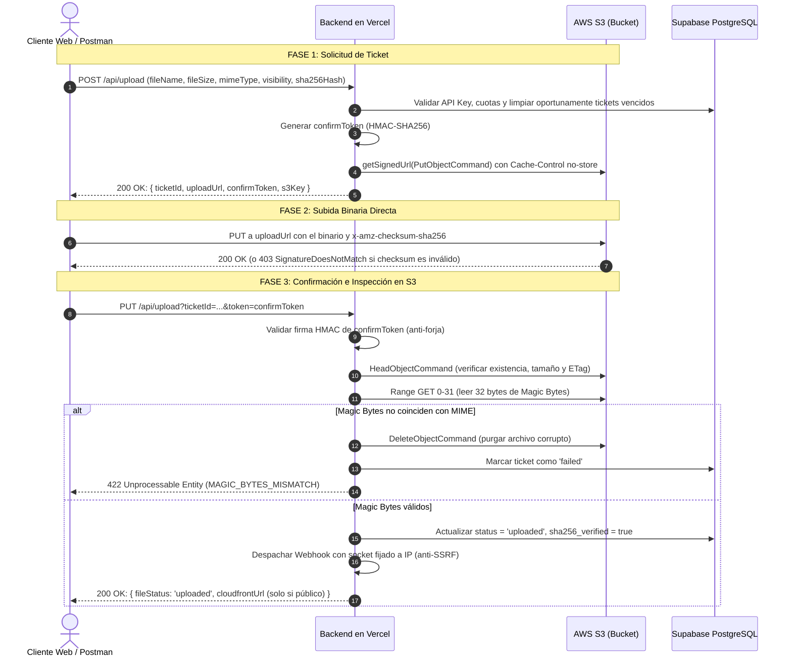

# Documentación Técnica del Servidor (`servicio`) — Arquitectura y Referencia

> **Versión:** 2.0.0  
> **Fecha:** 27 de Octubre de 2026  
> **Arquitectura:** Next.js 14 Serverless en Vercel + AWS S3 / CloudFront + Supabase PostgreSQL  
> **Regla de Arquitectura Fundamental:** *Ningún archivo binario pasa por Vercel*. Los bytes viajan exclusivamente entre Cliente y AWS S3 / CloudFront CDN. El backend opera exclusivamente en control plane (emisión de tickets, firmas criptográficas, verificación Range GET de 32 bytes, control de cuotas y webhooks).

---

## 📁 Estructura del Proyecto `servicio`

```text
servicio/
├── middleware.ts            # Interceptor perimetral Edge: Autenticación dual (Admin / API Keys), RBAC y Rate Limiting
├── next.config.js           # Configuración Next.js y validación estricta de variables obligatorias en arranque
├── database/                # Scripts DDL y esquemas SQL versionados
│   ├── api_keys_schema.sql  # Tabla api_keys, índices, columna can_manage_keys y trigger atómico
│   ├── rate_limit_buckets.sql # Tabla rate_limit_buckets y función RPC check_rate_limit_atomic
│   └── webhook_deliveries_schema.sql # Tabla webhook_deliveries y función RPC claim_webhook_deliveries
├── lib/
│   ├── env.ts               # Validador centralizado de 10 variables obligatorias y verificación de secretos
│   ├── supabase.ts          # Cliente administrativo Supabase PostgreSQL (service_role)
│   ├── s3.ts                # AWS SDK v3: firma presigned PUT/GET, multipart, HeadObject y Range GET 32b
│   ├── cloudfront.ts        # Generación de URLs públicas de CDN (d1nuawu3owad6c.cloudfront.net)
│   ├── magic-bytes.ts       # Detección e inspección de firmas binarias reales (PNG, JPEG, PDF, etc.)
│   ├── quotas.ts            # Control transaccional de cuotas (max_storage_bytes y max_pending_tickets)
│   ├── service-logs.ts      # Registro y consulta de pistas de auditoría (public.service_logs)
│   ├── ticket-token.ts      # HMAC-SHA256 de tokens de confirmación criptográficos (confirmToken)
│   ├── shared-rate-limit.ts # Rate limiting atómico en BD (hash SHA-256 de IP o UUID de llave, fail-open)
│   └── lambda-fallback/
│       ├── webhook-dispatcher.ts # Despacho HTTPS con socket fijado a IP (anti-SSRF/TOCTOU) y Circuit Breaker
│       └── process-upload.ts    # Pipeline de procesamiento [TEST-ONLY: apagado por defecto en prod]
└── app/
    ├── api/
    │   ├── health/route.ts      # Endpoint público de healthcheck
    │   ├── organizations/route.ts # Consulta y configuración de organizaciones y webhooks (Dual-Auth)
    │   ├── keys/route.ts        # Generador y gestor de API Keys (Dual-Auth, cupo atómico, anti-escalada)
    │   ├── upload/route.ts      # Flujo principal: Emisión de tickets PUT (POST) y confirmación (PUT)
    │   ├── upload/multipart/route.ts # Flujo multipart: create, presign_part, complete y abort
    │   ├── files/route.ts       # Listado de archivos por organización
    │   ├── files/[id]/route.ts  # Entrega directa (CloudFront público vs S3 prefirmado privado) y DELETE
    │   ├── files/[id]/status/route.ts # Estado transaccional y re-notificación manual de webhook
    │   ├── cron/maintenance/route.ts # Mantenimiento: limpieza de tickets, multiparts, webhooks y rate limits
    │   ├── webhooks/test-receiver/route.ts # Receptor y validador de firmas HMAC de webhooks de prueba
    │   ├── logs/route.ts        # Auditoría de logs administrativos
    │   ├── records/route.ts     # Métricas agregadas de archivos
    │   └── users/route.ts       # Gestión administrativa de usuarios internos
    ├── layout.tsx
    └── page.tsx                 # Vista administrativa de logs en tiempo real
```

---

## 1. Variables de Entorno Obligatorias (10)

El archivo [`lib/env.ts`](file:///C:/Users/alano/Desktop/github/cloudinary-project/servicio/lib/env.ts) y [`next.config.js`](file:///C:/Users/alano/Desktop/github/cloudinary-project/servicio/next.config.js) exigen la presencia estricta de exactamente 10 variables de entorno al arrancar el servicio. Si falta alguna, el arranque se aborta de forma inmediata sin permitir valores por defecto:

| Variable | Tipo / Alcance | Propósito |
| :--- | :--- | :--- |
| `AWS_ACCESS_KEY_ID` | IAM Credential | Identificador de credenciales de AWS para S3 y CloudFront. |
| `AWS_SECRET_ACCESS_KEY` | IAM Secret | Clave secreta para firmar peticiones de S3 (`PutObject`, `GetObject`, `Range GET`). |
| `AWS_REGION` | AWS Config | Región del bucket (fijada en `us-east-1`). |
| `AWS_S3_BUCKET_NAME` | S3 Config | Nombre del bucket (`practicas-alan-418272802078`). |
| `AWS_CLOUDFRONT_DOMAIN` | CDN Config | Dominio de CloudFront para entrega pública (`d1nuawu3owad6c.cloudfront.net`). |
| `SUPABASE_URL` | PostgreSQL URL | Endpoint REST / GraphQL de la base de datos Supabase. |
| `SUPABASE_SERVICE_ROLE_KEY` | DB Secret | Llave maestra `service_role` de Supabase para acceso administrativo con bypass de RLS. |
| `TICKET_SIGNING_SECRET` | Criptografía | Secreto HMAC-SHA256 para firmar y validar tokens de confirmación (`confirmToken`). |
| `ADMIN_API_SECRET` | Autenticación | Secreto maestro para rutas administrativas y creación de llaves de organización. |
| `CRON_SECRET` | Autenticación | Secreto Bearer para autorizar ejecuciones del cron de mantenimiento (`/api/cron/maintenance`). |

*(Nota: Para el almacenamiento de identificadores sensibles en la tabla `rate_limit_buckets`, las direcciones IP son hasheadas directamente mediante digest SHA-256 sin requerir variables adicionales).*

---

## 2. Esquema de Base de Datos y Tablas Críticas

### 2.1. Tabla `public.api_keys`
Almacena las credenciales de clientes garantizando arquitectura Zero-Knowledge:
* `id` (`UUID PRIMARY KEY`): Identificador único de la llave.
* `org_id` (`UUID NOT NULL REFERENCES organizations(id)`): Organización a la que pertenece la llave.
* `user_id` (`UUID NULL REFERENCES users(id)`): Usuario específico al que se vincula (si es llave personal). Si es llave de organización, es `NULL`.
* `name` (`TEXT NOT NULL`): Etiqueta descriptiva.
* `hashed_key` (`TEXT UNIQUE NOT NULL`): Hash SHA-256 de la llave plana. **Nunca se almacena la llave en texto plano.**
* `can_read` (`BOOLEAN DEFAULT false`): Privilegio de lectura de archivos y metadatos.
* `can_upload` (`BOOLEAN DEFAULT false`): Privilegio de solicitud y confirmación de tickets.
* `can_delete` (`BOOLEAN DEFAULT false`): Privilegio de eliminación de recursos.
* `can_manage_keys` (`BOOLEAN DEFAULT false`): Permite gestionar llaves hijas y configurar webhooks de la organización.
  * **Regla estricta:** Solo puede ser `true` si `user_id IS NULL`. Una llave vinculada a un usuario jamás gestiona llaves.
  * **Anti-escalada:** Una llave con `can_manage_keys=true` solo puede crear llaves con permisos iguales o menores a los que ella posee, y siempre crea llaves hijas con `can_manage_keys=false`.
  * **Protección de última llave:** No es posible eliminar la última llave administradora de una organización salvo con `ADMIN_API_SECRET`.
* `is_active` (`BOOLEAN DEFAULT true`): Bandera para revocación lógica.
* **Control de Cupo Atómico:** Trigger `trg_enforce_max_active_keys` con bloqueo `FOR UPDATE` sobre `organizations` que impide condiciones de carrera concurrentes (`Promise.all`), limitando las llaves activas al valor de `organizations.max_api_keys`.

### 2.2. Tabla `public.webhook_deliveries`
Maneja la cola transaccional y el historial de despachos de webhooks:
* `id` (`UUID PRIMARY KEY`): Identificador único de entrega.
* `org_id` (`UUID NOT NULL REFERENCES organizations(id)`): Organización destinataria.
* `file_id` (`UUID NOT NULL REFERENCES files(id) ON DELETE CASCADE`): Archivo asociado.
* `event_type` (`TEXT NOT NULL`): Evento (`file.uploaded`, `file.deleted`, etc.).
* `status` (`TEXT NOT NULL`): Estado (`pending`, `sending`, `delivered`, `failed`).
* `attempts` (`INT DEFAULT 0`): Intentos realizados.
* `max_attempts` (`INT DEFAULT 5`): Intentos máximos antes de marcar como fallido definitivo.
* `locked_until` (`TIMESTAMPTZ`): Bloqueo temporal anti-carreras para despachos en curso.
* `next_retry_at` (`TIMESTAMPTZ`): Marca temporal para reintentos con backoff exponencial.

### 2.3. Tabla `public.rate_limit_buckets`
Almacena los contadores atómicos del limitador distribuido:
* `key` (`TEXT PRIMARY KEY`): Identificador del bucket con formato estricto `<scope>:<kind>:<id>`. Para llaves API usa el UUID `api_keys.id`; para peticiones por IP usa el hash SHA-256 (`h:<sha256hex>`), garantizando privacidad y cumplimiento GDPR.
* `tokens` (`INT NOT NULL`): Peticiones consumidas en la ventana actual.
* `window_start` (`TIMESTAMPTZ NOT NULL`): Inicio de la ventana deslizante.
* `last_request_at` (`TIMESTAMPTZ NOT NULL`): Última petición registrada.
* **Limpieza:** Registros con `last_request_at > 1 día` son eliminados por el cron diario y de forma oportunista.
* **Comportamiento ante fallos:** La función `check_rate_limit_atomic` opera en modo **Fail-Open** (`allowed: true`) para evitar caídas de servicio ante fallos de conectividad con la base de datos, mientras que el limitador en memoria del Edge absorbe los picos abusivos.

---

## 3. Flujo de Subida y Regla "Zero Binaries on Vercel"



---

## 4. Políticas de Visibilidad y Entrega

### 4.1. Archivos Públicos (`visibility: 'public'`)
* **Landing Zone y Destino:** `static/files/<rand128>.<ext>`
* **Entrega:** Exclusivamente vía Amazon CloudFront CDN (`https://d1nuawu3owad6c.cloudfront.net/static/files/...`).
* **Cache-Control:** `public, max-age=31536000, immutable`.
* **Seguridad:** El backend persiste `cloudfront_url` en la base de datos para consumo directo de clientes.

### 4.2. Archivos Privados (`visibility: 'private'`)
* **Landing Zone y Destino:** `static/private/<rand128>.<ext>`
* **Entrega:** URL prefirmada directa de S3 con TTL corto de **5 minutos (300 segundos)** emitida únicamente al propietario verificado (`ownerUserId`).
* **Cache-Control:** `private, no-store, no-cache, max-age=0, must-revalidate`.
* **Seguridad:** En la base de datos y en todas las respuestas JSON, `cloudfront_url` es estrictamente `null`. Terceros que solicitan el archivo reciben `403 Forbidden` (`FORBIDDEN_PRIVATE_NOT_OWNER`).

---

## 5. Prevención de SSRF y Circuit Breaker de Webhooks

### 5.1. Conexión Fijada a IP (Anti-DNS Rebinding / Anti-TOCTOU)
Al despachar un webhook:
1. `validateWebhookUrlSSRF()` analiza la sintaxis y resuelve el nombre de dominio vía `dns.resolve()`.
2. `isIpBlocked()` analiza cada byte de la dirección IP y rechaza:
   - Loopback: `127.0.0.0/8`, `::1`
   - Red cero: `0.0.0.0/8`, `::`
   - Redes privadas: `10.0.0.0/8`, `172.16.0.0/12`, `192.168.0.0/16`, `fc00::/7`
   - Link-Local / Metadata: `169.254.0.0/16`, `fe80::/10`
   - Notaciones octales (`0177.0.0.1`), hexadecimales (`0x7f.1`) o enteros (`2130706433`).
3. `executePinnedHttpsPost()` abre el socket HTTPS fijando el agente al socket de la dirección IP previamente validada, conservando las cabeceras `Host` y el SNI TLS originales. Esto elimina completamente la ventana de tiempo (TOCTOU) para ataques de DNS Rebinding.

### 5.2. Circuit Breaker `[TEMPORARY-LAMBDA-FALLBACK: WEBHOOK-CIRCUIT-BREAKER]`
Si las últimas 3 entregas de una organización fallaron consecutivamente (`recentDeliveries.every(d => d.status !== 'delivered')`), el despachador abre el circuito y **encola la entrega automáticamente en segundo plano** (`status: 'pending'`, `error: 'CIRCUIT_BREAKER_QUEUED'`) sin bloquear la petición HTTP del usuario con reintentos síncronos ni agotar el timeout de 3.5 segundos. El cron de mantenimiento retoma los reintentos cuando el receptor se recupera.
